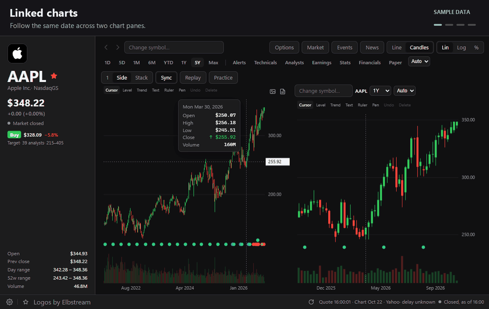
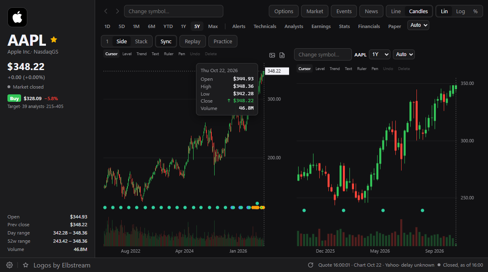
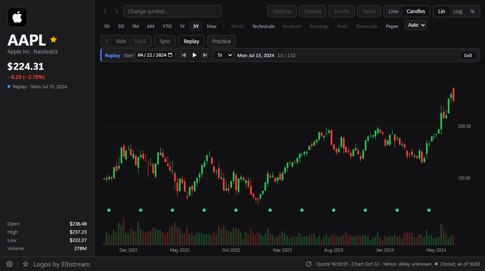
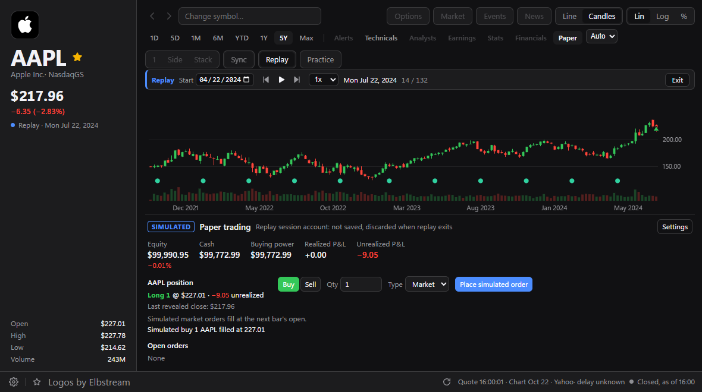
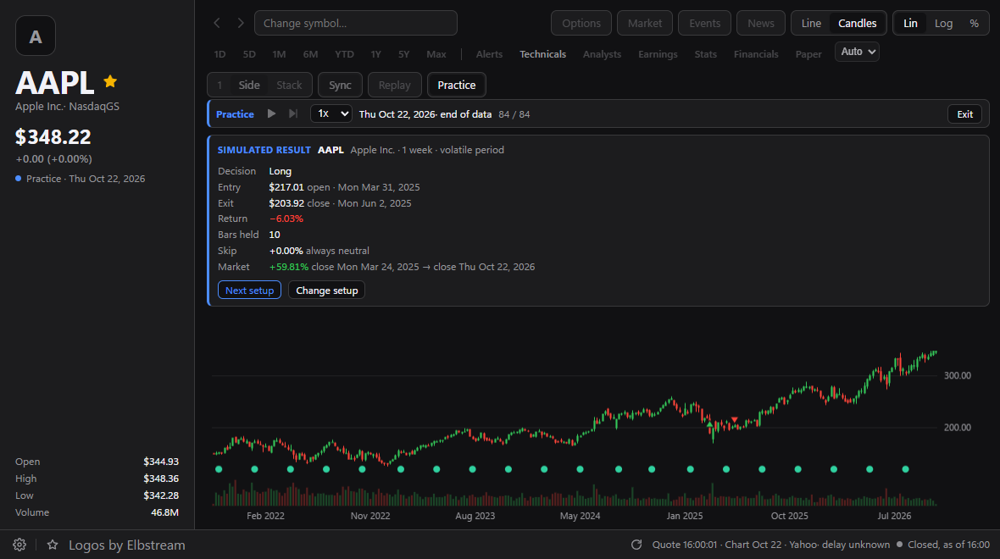

<p align="center"></p>

<p align="center">
  <a href="https://github.com/joezhuo2/tickr/releases/latest"></a>
  <a href="https://github.com/joezhuo2/tickr/releases"></a>
  <a href="https://github.com/joezhuo2/tickr/actions/workflows/ci.yml"></a>
  
  <a href="https://v2.tauri.app"></a>
  <a href="https://svelte.dev"></a>
  <a href="LICENSE"></a>
</p>

<p align="center">
  <a href="#download">Download</a> •
  <a href="#features">Features</a> •
  <a href="#settings-and-keybinds">Keybinds</a> •
  <a href="#screenshots">Screenshots</a> •
  <a href="#data">Data</a> •
  <a href="#files">Files</a> •
  <a href="#development">Development</a> •
  <a href="#contributing">Contributing</a> •
  <a href="#license">License</a>
</p>

> tickr is a stock watcher and trading practice app for the Windows tray and
> macOS menu bar. Hover over the tray icon for a quote, or use a global hotkey
> to open charts, watchlists, alerts and market research. Compare two charts,
> replay historical candles, and practice trades with simulated orders or
> randomly selected setups.

<p align="center"></p>

## Download

Get the latest installer from
[Releases](https://github.com/joezhuo2/tickr/releases/latest):

- **Windows:** `tickr_x.y.z_x64-setup.exe`. Installs per user, no admin
  prompt.
- **macOS:** `tickr_x.y.z_universal.dmg` (Apple silicon and Intel), macOS 10.15
  or later. Drag tickr into Applications.

### First launch

tickr is not code-signed yet, so both systems warn the first time you open
it. The builds come from the public
[release workflow](.github/workflows/release.yml), so you can check what went
into them.

- **Windows:** SmartScreen says "Windows protected your PC". Click
  **More info**, then **Run anyway**. You only see this once.
- **macOS 15 (Sequoia) or later:** open tickr and close the warning that it
  can't be verified. Go to **System Settings > Privacy & Security**, scroll
  down to the message about tickr and click **Open Anyway**, then confirm
  with your password.
- **macOS 14 or earlier:** right-click tickr in Applications, choose
  **Open**, then **Open** again.
- **macOS says tickr "is damaged and can't be opened":** the download was
  quarantined. Run this, then open it again:

  ```bash
  xattr -dr com.apple.quarantine /Applications/tickr.app
  ```

### Updates

From v0.5.1, tickr updates itself. It checks GitHub 30 seconds after launch
and every 12 hours. When a new version is out, the tray tooltip says so and
the update item in the tray menu reads **Install vX.Y.Z and restart**.
Nothing installs until you click it. tickr then downloads the update, checks
its signature against the key built into the app, installs it and restarts.
The first-launch warnings above don't come back after an update.

**Check for updates** checks right away. Turn off **Check for updates
automatically** to stop the background checks. Versions before v0.5.1 can't
update themselves: install v0.5.1 once from Releases.

## Features

- **Display settings:** choose System, Light or Dark, text size from 100% to 150%, and standard or accessible blue/orange gain and loss colors. Changes apply immediately and are saved.

### Tray and hotkey

- **Tray icon:** the company logo with an up/down badge. Hover for the
  quote, left-click to open the window, or to close it again the way the
  hotkey does if it's already open and focused. Right-click holds every on/off
  setting: show pre-market/after-hours, show change as % or $, always on top,
  unload window when minimized, start hidden, launch at login, check for
  updates automatically and, on macOS, show price in menu bar. If something
  needs attention (the hotkey is taken, or launch at login could not be
  changed), the tooltip ends with a ⚠ line.
- **Global hotkey** (default `Ctrl+Alt+K` on Windows, `⌘⇧K` on macOS): opens
  the window, or minimizes it if it's focused. On macOS, where tickr has no
  Dock icon, it hides the window instead (or unloads it, when unload is on).
  Change it in [Settings](#settings-and-keybinds). If another app owns the
  hotkey at startup, the window footer shows the error until you pick one
  that works.
- **Launch at login** is off until you turn it on. Once on, it survives
  upgrades: tickr re-registers itself if an installer removed the entry,
  unless you turned it off in Task Manager.
- **Unload when minimized** (on by default): minimizing destroys the web view,
  so the app drops to one process using about 7 MB. The hotkey reopens it
  already painted with the last chart and quote, then refreshes in the
  background. The window opens on a dark or light background to match the
  OS theme, so it never flashes white.

Windows may hide new tray icons in the overflow menu (^). Drag it onto the
taskbar to keep it visible.

### Chart

- **Symbol and range:** search to change the symbol, pick a range from 1D to
  Max and switch between line and candles. Search filters by asset type and
  exchange, and exact ticker matches come first. Press Enter on a typed ticker
  to open it directly. 1D, 5D and 1M charts reload about once a minute.
- **Sessions and time zone:** extended-hours candles can be shown or hidden on
  the chart without changing the tray quote setting. Pre- and post-market
  sessions are shaded, and chart times can use the exchange or local time zone.
- **Second chart:** the toggle (J by default) opens a second chart pane, side by
  side or stacked, with its own symbol and range. Crosshair time is linked
  across both charts. Turn on **Sync** to pan and zoom both panes together.
  tickr saves the layout across launches.
- **Recent symbols and history:** focus the empty search box to see the last
  10 symbols you viewed. The Back and Forward buttons (or Alt+Left and
  Alt+Right) step through this session's symbols, and B jumps to the previous
  one, so pressing it again toggles between two.
- **Price scales:** linear, logarithmic, or percentage change rebased to the
  first visible candle as you pan and zoom. Press L to cycle scales.
- **Drawings:** the toolbar places levels, trendlines, text and freehand pen strokes, saved per symbol.
  Keys 1 to 5 pick the level, trendline, text, ruler and pen tools.
  Drag to move them or adjust trend endpoints, and Delete removes the selection.
  Ctrl+Z undoes, Ctrl+Shift+Z redoes, and Escape returns to Cursor. The ruler
  measures price, percent, bars and elapsed time without saving.
- **Candle interval:** choose Auto to keep the default resolution for each
  range, or select a supported interval independently. The choice is saved
  and resets to Auto when switching to a range that does not support it.
- **Candle countdown:** on a live intraday chart, the bottom right corner shows
  the time left until the forming candle closes.
- **Tooltip:** hover the chart, or use ← and →, for time, open, high, low,
  close and volume.
- **Zoom and pan:** scroll or pinch to zoom at the cursor (down to 10 bars),
  drag or scroll sideways to pan, and double-click to see the whole range
  again. With the chart focused, + and - zoom and 0 resets. The price axis
  fits the visible bars, and a zoomed view follows new bars at the right edge.
- **Event dots** along the bottom of the chart; hover the candle for details:

  | Dot | Marks |
  | --- | --- |
  | Blue | Earnings report: quarter and EPS vs estimate (last four quarters) |
  | Orange | Analyst initiation, upgrade or downgrade: firm, ratings, new target |
  | Yellow | One of the 20 latest headlines |
  | Green | Ex-dividend date and amount (6M to Max) |
  | Purple | Stock split and ratio (6M to Max) |

  Dots stack when a candle has more than one. A news dot gets a smaller inner
  circle: green when that candle's headlines lean positive, red when they lean
  negative, and plain when neutral. Earnings, news and rating dots can be
  turned off in Settings.
- **Exports:** hover the chart for two buttons at its top left. One copies
  the chart as a PNG image, the other its candles as CSV (time in UTC, open,
  high, low, close, volume). A button turns green once the copy lands.
- **Refresh:** the button in the bottom bar fetches the quote and reloads the
  chart right away, then force-reloads the panel on screen (News, Earnings,
  Stats, Financials, Analysts, Events, Market, Options or the Watchlist cards). The bar
  says "<Panel> refreshed" or shows the error, and a failed refresh keeps what
  was already shown. **Background refresh** in Settings defaults to **Balanced**:
  quotes update every 15 seconds during regular trading, 60 seconds pre/post-market,
  and 15 minutes when closed. **Low-power** keeps that cadence while visible and
  slows it to 60 seconds, 5 minutes, and 30 minutes while hidden or minimized.
  Armed alerts keep their usual 15-second cadence in either mode. Low-power pauses
  automatic minute chart and watchlist refreshes while hidden and refreshes stale
  data when shown. Quotes also refresh promptly after system wake or network recovery.

### Replay and trading practice

- **Bar replay** (`Y`) starts at a historical date you choose. Play at an
  adjustable speed or step forward and back one candle at a time. Indicators
  use only the candles you've revealed. tickr hides live quotes and research
  panels during the session.
- **Paper trading** (`H`) simulates market, limit and stop orders for long and
  short positions. Set commission and slippage, track realized and unrealized
  P&L, and review fills on the chart. The account used with current quotes is
  saved to `paper.json`. Replay uses a separate account for the session, and
  simulated market orders fill at the next revealed candle's open.
  The **Position size** row turns an account size, risk %, entry and stop into
  a share count, the amount at risk and the 2R target; it defaults to the paper
  account's equity and the current price, and **Use in ticket** copies the side
  and quantity into the order ticket.
- **Random historical practice** (`Q`) draws a symbol and starting point from
  your watchlist or a group, using the candle interval and date range you pick.
  Choose **Long**, **Short** or **Skip** with future candles hidden. Close at a
  revealed candle's close to see your return, bars held and how you did against
  skipping the trade.
- **Strategy backtesting** (`.`) runs entry and exit rules over the loaded
  chart. Build conditions from menus or type expressions such as
  `crosses_above(sma(20), sma(50)) and rsi(14) < 70`, using price fields,
  `sma`, `ema`, `rsi`, `crosses_above`, `crosses_below`, comparisons,
  arithmetic and `and` / `or` / `not`. Session terms cover intraday setups:
  `time` (exchange time as HHMM, so 945 is 9:45), `vwap`, `atr(n)`,
  `or_high(minutes)` and `or_low(minutes)` for the opening range once it is
  complete, `day_high` and `day_low` for the regular session before the current
  bar, and `prev_high`, `prev_low`, `prev_close` for the prior day on the chart.
  Entries and exits fill at the next candle's open, with an optional stop-loss
  and take-profit. Set an **Entry stop price** such as `or_high(15)` to buy
  where a bar trades up through that level instead (at the open if it gaps
  above); the entry condition then only arms the order. The **ORB example**
  link fills in a 15-minute opening range breakout. A stop-loss can trigger on
  the entry bar, since the order of prices inside one candle is unknown. The report lists
  each trade with win rate, total return, max drawdown, average trade and a
  buy-and-hold comparison, and marks trades on the chart.

### Views

Each tab or button below swaps the chart out; click it again, or a range, to
go back.
Views fade in, the watchlist slides up, Settings scales open and switching
line / candles fades the chart. With the OS reduced-motion setting on, all of
it is instant.

- **Technicals:** click **Analyze** to run RSI, moving averages, candlestick
  patterns and volatility/Fibonacci targets on the candles of the selected
  range, on your machine (same candles, same result). You get a score from
  −100 to +100 with a bias and confidence, upside and downside targets for the
  next 10 bars, an invalidation level and the signals behind the score.
  Checkboxes toggle moving averages, Bollinger bands, VWAP, the opening range,
  key levels, the volume average, the volume profile, Fibonacci levels, targets, pattern markers, RSI and MACD panes. Indicator settings let you edit
  lengths, colors (or reset to the theme), and individual line visibility, with
  up to eight SMA and eight EMA lines. MACD defaults to 12/26/9 and starts hidden.
  Settings and up to 50 named presets persist across launches; saving an existing
  name replaces that preset. Display settings never change the score, signals,
  or targets, which retain their fixed indicator lengths.
  Analysis refreshes when new candles arrive. Enable **Keep analysis on** to
  also run it at startup and after symbol, range or interval changes; otherwise
  those changes clear the results until you click Analyze again. Overlay
  visibility is preserved. VWAP resets each day on intraday charts and is
  anchored to the first candle on daily and longer intervals. Short histories
  show warm-up estimates and reduced confidence. Computed locally; not
  investment advice.
  Once analyzed, the overlays and RSI / MACD panes stay on the chart after you
  close the Technicals tab, including in Paper trading and Strategy. Press `Z`
  there to analyze or re-analyze without opening the tab.
  Drag the border above the Technicals panel, or focus it and press ↑ or ↓, to
  resize the panel; double-click the border to reset it. The height is
  remembered.
  **Volume average** draws a moving average of volume (20 bars by default) over
  the volume bars, and the Indicators list shows **Relative volume**: the
  latest bar's volume divided by the average of the 20 bars before it. The
  latest bar is still forming on a live chart, so its relative volume reads low
  until the bar closes.
  **VWAP bands** (Bands σ in Indicator settings, 0 to 5, off at 0) draw lines
  that many volume-weighted standard deviations above and below VWAP.
  **Volume profile** (off by default) shows volume by price for the candles on
  screen as bars along the right edge, with the busiest price band darker. The
  Indicators list also shows **ADX 14** next to the existing ATR 14.
  **Opening range** (off by default, intraday charts only) draws the high, low
  and midpoint of the first minutes of each regular session, 15 by default and
  1 to 240 in Indicator settings. The lines grow while the range forms and then
  hold for the rest of the day. **Extension** adds target lines that many range
  heights above the high and below the low; 0 hides them. The area between
  the high and low is shaded as a box.
  **Key levels** (off by default, intraday charts only) draws the prior day's
  regular-session high and low (PDH, PDL) and today's premarket high and low
  (PMH, PML), each labeled with its price. Premarket levels need extended
  hours shown on the chart. On a 1D chart the prior day comes from one extra
  daily-candle request per analysis.

- **Analysts:** the rating (Strong buy to Sell), average 12-month target and
  its upside also sit under the price on the left. The tab adds the target
  range against the current price and the count of each rating. Cached for 12
  hours; ETFs, indices and crypto have no coverage.
- **Earnings:** the next report date (confirmed or estimated) with EPS and
  revenue estimates, and the last four quarters with estimate, actual and
  surprise % (green beat, red miss).
- **Stats:** key statistics in Valuation, Trading, Dividends & splits, Shares
  & short interest, Profitability and Financials. ETFs get a Fund section and
  crypto a Crypto section. Changes, growth and returns are green or red.
- **Financials:** revenue, net income, free cash flow and gross, operating and
  net margins over the reported periods, with an Annual / Quarterly toggle, two
  small trend charts and a table. Margins are computed from revenue, and
  figures Yahoo does not report show as —. Cached for 12 hours; ETFs, indices
  and crypto have no statements.
- **News feed:** choose Watchlist or a named group in News to combine headlines,
  deduplicate stories and filter by ticker, publisher and topic.
- **News:** the 20 latest headlines, newest first, with publisher, time and a
  Positive / Negative / Neutral pill. The sentiment is guessed on your machine
  from the headline's words, so take it as a hint. Click one to open it in
  your browser.
- **Market:** the S&P 500, Nasdaq, Dow, Russell 2000 and VIX; the 10-year
  yield, crude oil, gold, the dollar index and Bitcoin; the 11 S&P sector ETFs
  by day change; and the day's top 5 gainers and losers. Click a row to chart
  it.
- **Options:** the option chain for the current symbol, calls or puts one
  side at a time, for any expiry (type a YYYY-MM-DD date or pick from the
  list). Strikes sit above or below the current price, in-the-money rows are
  tagged, and each row shows last, bid/ask, change, volume, open interest,
  implied volatility and last trade time.
  Add legs from the chain to build a strategy (presets include spreads,
  straddles and iron condors) and see its expiration payoff, break-evens and
  max profit and loss.

### Watchlist

Click the star next to the ticker to add or remove it. The star in the bottom
bar shows starred stocks as cards with price and percent move for the current
session, including pre-market or after-hours when available. Sort by change,
price or volume, or switch to a heatmap whose tiles are colored by day change
and sized by the magnitude of the move. Use the screener to filter by RSI,
moving averages and daily change, and save filters you want to reuse.

**Groups** split the watchlist into tabs such as "Tech" or "Crypto"; **All**
always shows every starred stock. Click **+** and type a name to add a group.
In a group tab, **Edit** shows every starred stock: click cards to add or
remove them, rename the group, or **Delete** it. Unstarring a stock removes it
from every group. Press `G` to cycle through All and each group (opening the
Watchlist if it is closed).

**Table** shows the watchlist as rows with price and change, plus optional
columns you switch on: analysis **Score**, **RSI** (14), **days to earnings**
and **IV rank**. IV rank is an estimate: the at-the-money implied volatility
placed within the past year's range of 30-day realized volatility, since Yahoo
has no implied-volatility history. Column data is only fetched while the column
is on.

### Price alerts

Open **Alerts**, to the left of Technicals, to add an alert for the selected
symbol. Pick a kind: **Price** (at or above or below a level, in the trading
currency), **Day move %** (up or down X% from yesterday's close), **Move since
armed %** (up or down X% from the price when armed), **Trailing %** or
**Trailing amount** (falls by that much from the high since arming, or rises
from the low). The list includes alerts for every symbol. **Pause**, **Rearm**
and **Delete** manage them, **Edit** changes an alert's direction and level, and
**Duplicate** copies it. Click an alert's ticker to open its chart, and filter
the list by All, Armed, Triggered or Paused. Triggered alerts show the trigger
price and time. By default an alert fires once and then shows
**Triggered**; tick **Recurring** to keep it armed, with a cooldown in minutes
(default 15) during which it stays quiet. A recurring alert needs a fresh
crossing to fire again. **Regular session only** ignores extended-hours
prices and checks nothing outside the regular session.

Armed symbols are checked about every 15 seconds while tickr is running,
including with the window closed and when viewing a different stock. The
first successful price after arming or restarting establishes a baseline;
the next crossing sends a native desktop notification. Move-since-armed and
trailing alerts take their reference price from the first price after arming
and save it, so a trailing stop breached while tickr was closed fires on the
first price after restart. Extended-hours prices are used when available.
Alerts and their triggered state are saved across restarts. Allow tickr
notifications in your OS settings; on Windows, use an
installed build for notifications. Quotes can be delayed and crossings between
polls can be missed.

### Settings and keybinds

The gear at the bottom left opens Settings. A menu on the left switches between
Display, Hotkeys, Chart, Market data, AI, Backup and Connections. Hotkeys holds
the global hotkey (click the field and press a new combination; **Reset**
restores the default) and the in-window keybinds; Chart holds the session
shading and chart dot toggles. Esc or a click outside closes it.

Keybinds are grouped by category. Click a keybind and press a new key to rebind it (an action already on that
key takes the old one), or Backspace to unbind it. Keybinds are ignored while
typing in a text field.

| Category | Key | Action |
| --- | --- | --- |
| Chart | `C` | Switch line / candles |
| | `L` | Cycle price scale (Lin, Log, %) |
| | `I` | Cycle candle length (Auto, then the lengths the range allows) |
| | `1` | Draw level (press again for Cursor) |
| | `2` | Draw trendline |
| | `3` | Draw text |
| | `4` | Ruler |
| | `5` | Pen |
| | `J` | Toggle second chart |
| | `Y` | Toggle bar replay |
| | `H` | Open Paper trading |
| | `Q` | Start random practice |
| | `V` | Cycle date range |
| | `R` | Refresh |
| Indicators | `6` | Toggle opening range |
| | `7` | Toggle key levels |
| | `8` | Toggle volume average |
| | `9` | Toggle volume profile |
| Panels | `T` | Open Technicals |
| | `Z` | Analyze / re-analyze |
| | `A` | Open Analysts |
| | `E` | Open Earnings |
| | `P` | Open Alerts |
| | `M` | Open Market |
| | `K` | Open Events |
| | `N` | Open News |
| | `O` | Open Options |
| Options | `U` | Switch calls / puts |
| | `D` | Next expiry date (wraps around) |
| Watchlist | `W` | Toggle Watchlist |
| | `X` | Next watchlist stock |
| | `G` | Next watchlist group (opens the Watchlist) |
| | `F` | Add stock to Watchlist |
| General | `S` | Focus search |
| | `B` | Previous symbol (toggles between two) |
| | `,` | Toggle Settings |
| Fixed | `Alt+←` | Back to the previous symbol in history |
| | `Alt+→` | Forward in history |

**Backup** exports your settings, watchlists, groups, drawings, alerts, saved
screens, keybinds and indicator presets to a JSON file, and **Import** restores
one after checking it. API keys stay in `.env` and are never exported; the data
provider, window position and start-at-login setting are kept on import.

### AI news analysis

Headline tone (the dots on the chart and the News view) comes from a local
keyword lexicon by default. Optionally, Settings > AI > News analysis sends new
headlines to any OpenAI-compatible chat-completions endpoint (OpenAI, Ollama,
LM Studio, ...) to classify them as positive, neutral or negative. Fill in the
base URL (for example `https://api.openai.com/v1`), the model and, if the
endpoint needs one, the API key. The key may stay empty for local endpoints. A saved key is never sent back to
the page: the field shows "Key saved", leaving it blank keeps the key, and Clear
removes it. **Test connection** saves the settings and checks each configured model.

Model is the master model. To use a different one for a feature, fill in News
model (headline tone) or Events model (event analysis); a blank field uses
Model.

These are saved to `.env.local` in the settings folder (see [Files](#files)),
not to `settings.json`, as `TICKR_AI_BASE_URL`, `TICKR_AI_MODEL`,
`TICKR_AI_NEWS_MODEL`, `TICKR_AI_EVENTS_MODEL` and `TICKR_AI_API_KEY`; other
lines in that file are left alone. Results are cached
per model and headline in the cache folder, so each headline is sent once. If
AI is off, not configured or a call fails, the keyword tone is used.
News labels each tone **AI** or **Keyword**; hover for the model and generation time.

Settings > Connections shows quote, news and AI status, last successes and
readable errors, with a Retry action for each service. **Copy diagnostics**
copies app and OS versions and connection details with credentials redacted.

### Market events

The Events panel (header button or `K`) has three tabs.

**Economic** lists seven days of releases from Yahoo's economic calendar,
grouped by day, each with its local release time and, where Yahoo has them, the
actual, expected and prior figures. It starts with the next 7 days; the arrows
step a week back or forward (up to about a year either way) and **Today**
returns. The country menu picks which countries to show (US by default, or all)
and **All / Key** limits the list to headline releases (jobs, inflation, GDP,
rates, PMIs, retail sales, confidence). Yahoo does not rate importance, so Key
is decided by release name and is only a rough guide. Both choices are saved in
settings. The list needs no AI and is refreshed every 15 minutes or with the
Refresh button.

**Watchlist** merges the upcoming earnings dates and ex-dividend dates of your
starred symbols into one list by day, with an All / Earnings / Ex-dividend
toggle. Click a row to open that symbol. Estimated earnings dates are marked and
the EPS estimate is shown when Yahoo has one. Dates are cached for 6 hours and
fetched three symbols at a time; ETFs, indices and crypto have none.

**Calendar** combines both: your watchlist's earnings and ex-dividend dates
next to the macro releases, grouped by day, with the same week arrows and the
saved country and All / Key filters applied to the macro rows.

Clicking an event asks the AI configured in Settings, as above, using the
Events model or else Model, to analyze that
one release: a summary and the affected stocks and sectors, each with a score,
confidence and reasoning. Only the opened event is sent, along with its figures
and a few current Yahoo headlines about it. Analyses are cached for 6 hours per
model, and a new one is made once the actual figure is out. Details show the model
and generation time; **Regenerate** requests a fresh analysis for that event.

## Screenshots

The demo and screenshots use sample data. Click an image to view it at full
size.

| | |
| :---: | :---: |
| [](assets/screenshots/split-charts.png)<br>**Linked charts** let you inspect the same date in two date ranges. | [](assets/screenshots/bar-replay.png)<br>**Bar replay** reveals candles at your pace. |
| [](assets/screenshots/paper-trading.png)<br>**Paper trading** shows the filled order and open position. | [](assets/screenshots/historical-practice.png)<br>**Historical practice** shows how a trade performed against skipping. |
| [](assets/screenshots/chart.png)<br>**Chart** shows candle details and lets you copy a PNG or CSV. | [](assets/screenshots/technicals.webp)<br>**Technicals** computes signals and targets from the chart's candles. |
| [](assets/screenshots/market.png)<br>**Market** groups indices, sectors and daily movers. | [](assets/screenshots/watchlist.png)<br>**Watchlist** keeps prices and session moves for starred symbols together. |

## Data

Quotes, charts, news and fundamentals come from Yahoo Finance's public chart,
search and quoteSummary endpoints. They are not an official API and can change
or rate-limit without notice, and quotes may be delayed. Logos come from
[Elbstream](https://elbstream.com/logos)'s logo API (formerly Parqet); the
**Logos by Elbstream** link in the footer is the attribution its free tier
requires. Analysis and sentiment run on your machine. Not investment advice.

## Files

| What | Windows | macOS |
| --- | --- | --- |
| Settings | `%APPDATA%\tickr\settings.json` | `~/Library/Application Support/tickr/` |
| AI credentials | `%APPDATA%\tickr\.env.local` | `~/Library/Application Support/tickr/` |
| Logo, AI tone and event analysis cache | `%LOCALAPPDATA%\tickr\` | `~/Library/Caches/tickr/` |
| Logs | `%LOCALAPPDATA%\dev.tickr.desktop\logs\tickr.log` | `~/Library/Logs/dev.tickr.desktop/` |

Logs rotate at 1 MB and keep two old files. Attach `tickr.log` to bug reports.

Uninstalling on Windows removes the launch-at-login entry. Check "Delete the
application data" in the uninstaller to also remove settings, the logo cache,
logs and WebView data.

## Development

### Build

Requirements: Rust 1.85+, Node 20+, and the
[Tauri 2 prerequisites](https://tauri.app/start/prerequisites/).

```bash
npm install
npm run tauri dev          # dev build with hot reload
npx tauri build            # installer (NSIS on Windows, .app and .dmg on macOS)
```

`npx tauri build` also signs the updater bundles, which needs the private key
(see [Updater key](#updater-key)). Without it, skip the updater artifacts:

```bash
npx tauri build -c '{"bundle":{"createUpdaterArtifacts":false}}'
```

The Windows installer installs per user (no UAC prompt), in English. On
macOS, `src-tauri/Info.plist` sets `LSUIElement` so tickr never shows a Dock
icon; the minimum version is macOS 10.15.

### Releasing

Releases are built by GitHub Actions. Bump the version in `package.json`,
`src-tauri/Cargo.toml` and `src-tauri/tauri.conf.json`, add a `CHANGELOG.md`
entry, then push a tag:

```bash
git tag v0.11.14
git push origin v0.11.14
```

`.github/workflows/release.yml` builds the Windows NSIS installer and a
universal macOS `.app`/`.dmg` with `tauri-apps/tauri-action`, and attaches them
to a **draft** release for that tag, along with the signed updater bundles and
`latest.json`. Failed asset uploads are retried twice. A last job checks that
`latest.json` lists Windows and both macOS architectures; if it fails, re-run
the failed jobs from the Actions tab, which re-uploads into the same draft. Review the notes and publish the release from the
Releases page. Installed copies only see it once it is published and marked
latest (not a pre-release), because the updater reads
`releases/latest/download/latest.json`.

#### Updater key

Updates are signed with a minisign key pair, separate from code signing and
free. The public key is `plugins.updater.pubkey` in
`src-tauri/tauri.conf.json`. The private key stays off the repo, in
`~/.tauri/tickr.key`, and CI reads it from the `TAURI_SIGNING_PRIVATE_KEY`
repository secret. Set it to the file's contents, unchanged (one base64 line):

```bash
gh secret set TAURI_SIGNING_PRIVATE_KEY < ~/.tauri/tickr.key
```

The key has no password, so leave `TAURI_SIGNING_PRIVATE_KEY_PASSWORD` unset.
If the secret is missing or mangled, tauri fails at the end of the build with
"Missing comment in secret key"; the release workflow checks the secret first
and fails right away instead.

Back the key up somewhere safe. If it is lost, installed copies reject every
future update and users have to reinstall by hand. A local `npx tauri build`
needs the same two variables, or it fails at the updater signing step.

`.github/workflows/ci.yml` runs `npm run check`, `npm test`,
`cargo clippy -- -D warnings` and `cargo test` (Windows and macOS) on every
push to `main` and every pull request.

#### Code signing

Releases are not code-signed yet (see [First launch](#first-launch)). macOS
builds are ad-hoc signed (`bundle.macOS.signingIdentity: "-"`), so Gatekeeper
reports an unidentified developer rather than a damaged app. Signing needs
certificates, so it is set up through environment variables at build time
rather than in the repo.

**macOS** needs a Developer ID Application certificate in the keychain and an
Apple ID app-specific password (or an App Store Connect API key) for
notarization. Remove `"signingIdentity": "-"` from `tauri.conf.json` first;
`tauri build` signs, notarizes and staples when these are set:

```bash
export APPLE_SIGNING_IDENTITY="Developer ID Application: Your Name (TEAMID)"
export APPLE_ID="you@example.com"
export APPLE_PASSWORD="app-specific-password"
export APPLE_TEAM_ID="TEAMID"
npx tauri build --target universal-apple-darwin
```

**Windows** can use an Authenticode certificate (set
`bundle.windows.certificateThumbprint`, `digestAlgorithm: "sha256"` and a
`timestampUrl` in `tauri.conf.json`) or Azure Trusted Signing (set
`bundle.windows.signCommand` to a `trusted-signing-cli` call). See
[Windows code signing](https://v2.tauri.app/distribute/sign/windows/) and
[macOS code signing](https://v2.tauri.app/distribute/sign/macos/). In CI, add
the Apple values as repository secrets (plus `APPLE_CERTIFICATE`, the base64
`.p12`, and `APPLE_CERTIFICATE_PASSWORD`) and uncomment them in
`release.yml`.

`npm run icon` regenerates the app icons from `scripts/make-icon.mjs`.

### Tests

```bash
cd src-tauri && cargo test # technical analysis (indicators, patterns, Fibonacci, scoring), quote, analyst, earnings, rating change, stats, financials, market and news parsing, headline sentiment, sessions, tray tooltip and title, icon compositing, settings, watchlist symbols and groups, economic calendar and watchlist dates, update menu labels
cd src-tauri && cargo test -- --ignored live   # analyst, market, financials, economic calendar and watchlist date fetches against Yahoo (network)
npm test                   # formatters, watchlist sort, calendar filters and dates, hotkey recording and display, keybinds
npm run check              # svelte-check
```

### Layout

```
src-tauri/src/
  quote.rs      Yahoo chart/search: fetch, parse, market session, extended-hours price
  analysis/     local technical analysis: indicators (RSI, SMA/EMA, ATR, σ), patterns, Fibonacci swing, score and targets
  analyst.rs    Yahoo quoteSummary: cookie/crumb session, consensus and price targets, 12 h cache
  earnings.rs   Yahoo quoteSummary: past EPS reports and next report date
  events.rs     Yahoo economic calendar: any week, all countries, paged; AI analysis of one event on demand, 6 h cache
  calendar.rs   Yahoo quoteSummary calendarEvents: earnings and ex-dividend dates per watchlist symbol, 6 h cache
  grades.rs     Yahoo quoteSummary: analyst upgrades, downgrades and initiations
  stats.rs      Yahoo quoteSummary: key statistics in labeled sections
  financials.rs Yahoo fundamentals-timeseries: annual and quarterly revenue, net income, gross and operating profit, free cash flow, 12 h cache
  market.rs     Yahoo batch quotes and screeners: indices, macro, sectors, top movers
  news.rs       Yahoo search news: 20 latest headlines, newest first, web links only
  sentiment.rs  headline tone (positive, negative, neutral) from a financial keyword list
  poller.rs     Balanced/Low-power refresh, alert cadence, system wake and network recovery
  tray.rs       tooltip text, macOS menu bar title, and the right-click menu
  trayicon.rs   icon (32 px, 36 px on macOS): logo in a rounded square plus a direction badge
  logo.rs       Elbstream logo fetch with a disk cache
  window.rs     create, OS theme background, reveal after first paint, unload on minimize, geometry
  hotkey.rs     global shortcut register/swap with rollback
  commands.rs   window commands and the injected first-frame payload
  settings.rs   JSON settings in the OS config dir
  autostart.rs  launch at login: restores the Run entry after upgrades
  updater.rs    background update checks, tray menu state, install and restart
src-tauri/windows/hooks.nsh   NSIS uninstall hook: autostart entry and app data
.github/workflows/  ci.yml (checks on push/PR), release.yml (installers, updater bundles and latest.json on tag push)
ui/src/         App, Left (ticker and details), Chart (canvas, analysis overlays), Technicals, Analysts, Earnings, Stats, Market, Events, WatchCalendar, News, Watchlist, Search, Settings, Footer
```

### Memory (Windows 11, release build)

| State | Processes | Private |
| --- | --- | --- |
| Window open | 7 | 132 MB |
| Window unloaded (tray only) | 1 | 7 MB |

## Contributing

See [CONTRIBUTING.md](CONTRIBUTING.md). Bug reports should include
`tickr.log`, your OS and the tickr version.

## Market data

Yahoo is the default; no provider configuration is required. To use Alpaca, open Settings > Market data, choose Alpaca, select a feed, enter your key ID and secret, then Save and Test connection. Blank key fields keep saved credentials. Clear keys removes them and switches back to Yahoo.

Free Alpaca keys provide real-time IEX trades for US stocks. IEX covers one exchange; the paid SIP feed provides consolidated US market data and requires the appropriate subscription. Only symbols of one to five uppercase letters use Alpaca. Indices, crypto, foreign listings and symbols such as BRK-B continue to use Yahoo. Yahoo also supplies company metadata, sessions, corporate actions and quote volume. Alpaca supplies selected-stock prices and chart candles, with automatic Yahoo fallback on failure. The footer shows the actual quote source and stream status.

Watchlist quotes and alerts still use Yahoo because free Alpaca keys allow 200 requests per minute. The stream subscribes only to the selected stock, using one connection (the free plan allows one connection and 30 symbols). Polling continues as a backstop. Authentication, connection-limit and subscription errors pause stream retries until the symbol or provider configuration changes.

Keys are stored in `.env.local` in tickr's OS configuration directory, alongside the AI configuration, and are never returned to the page. `settings.json` stores only the provider and feed. Changing market data settings reloads the chart.

## License

MIT. Company logos are provided by [Elbstream](https://elbstream.com/logos).
