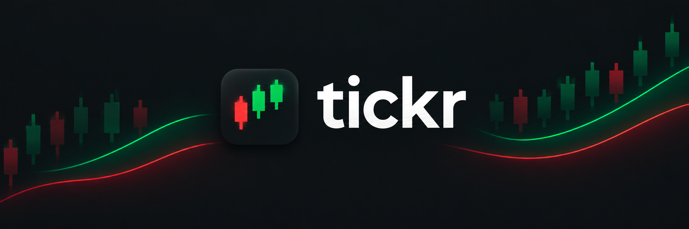
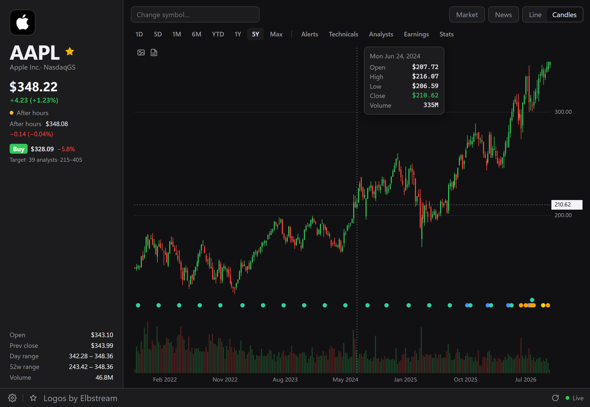
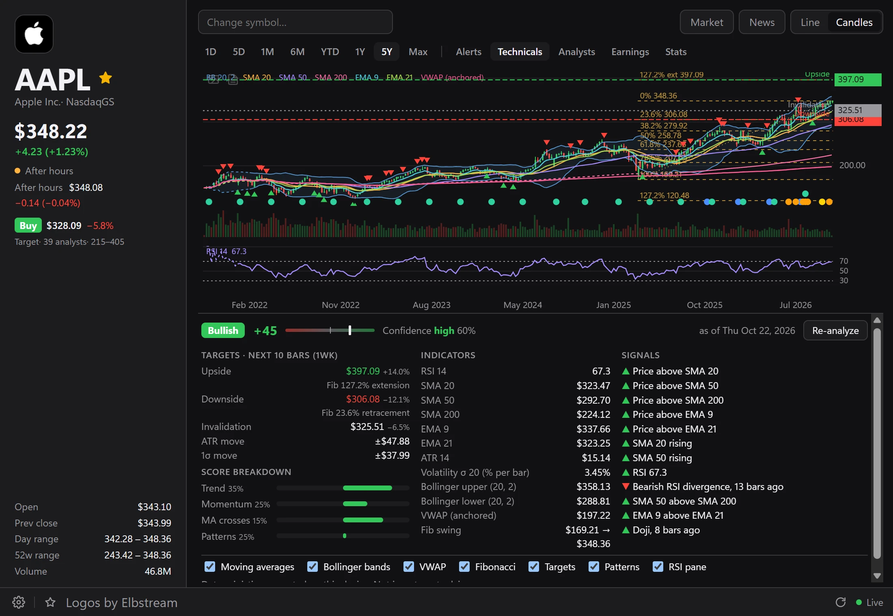
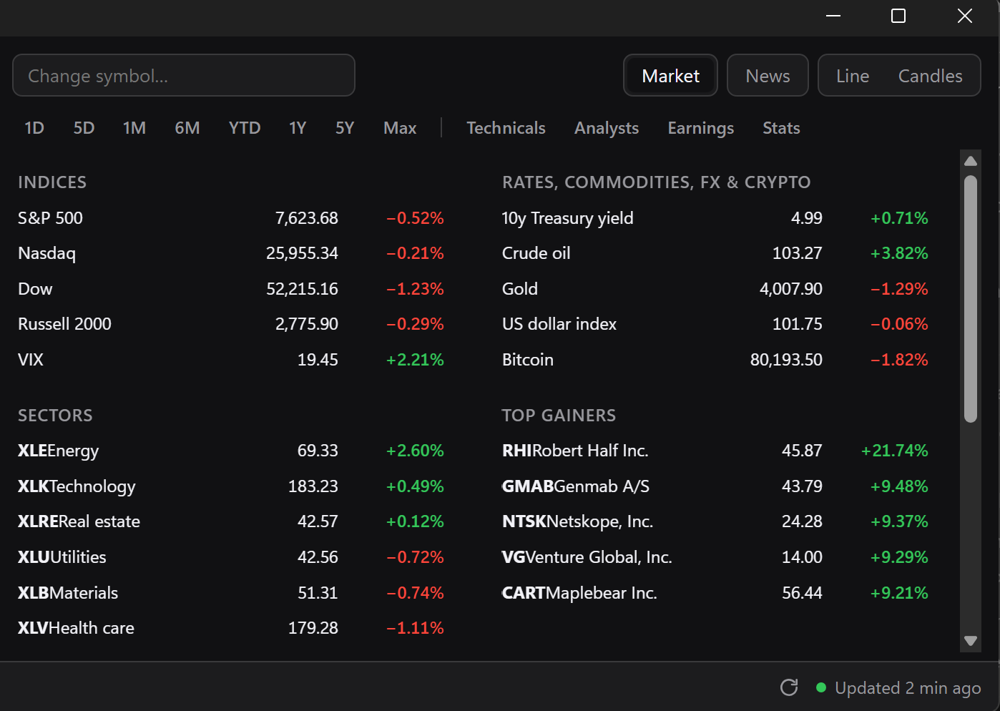
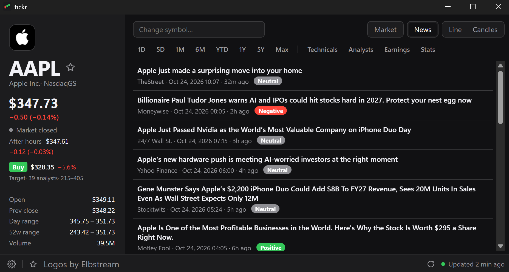
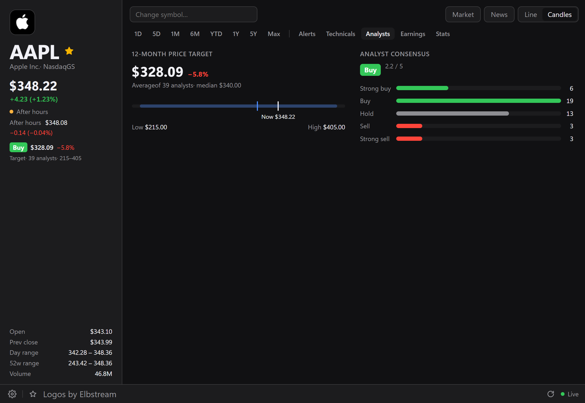
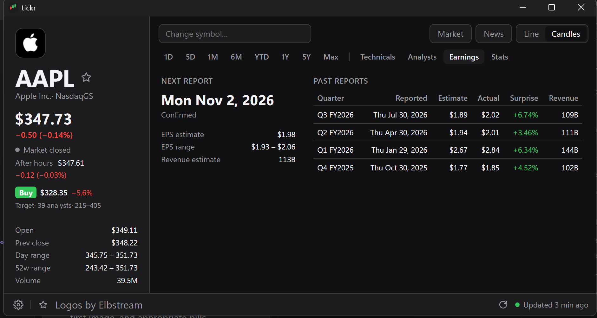
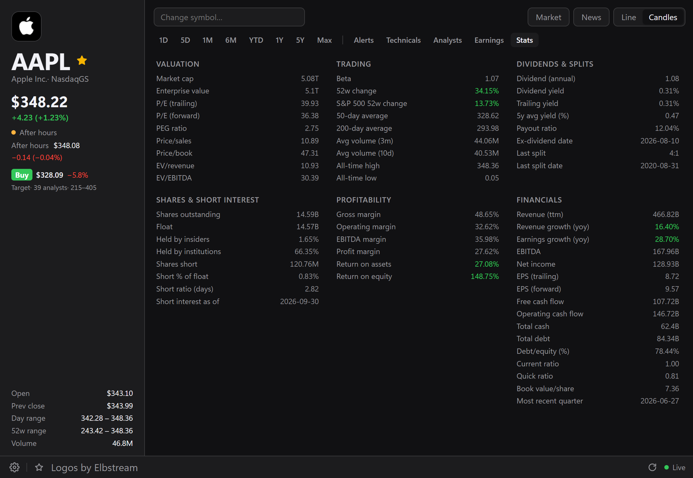
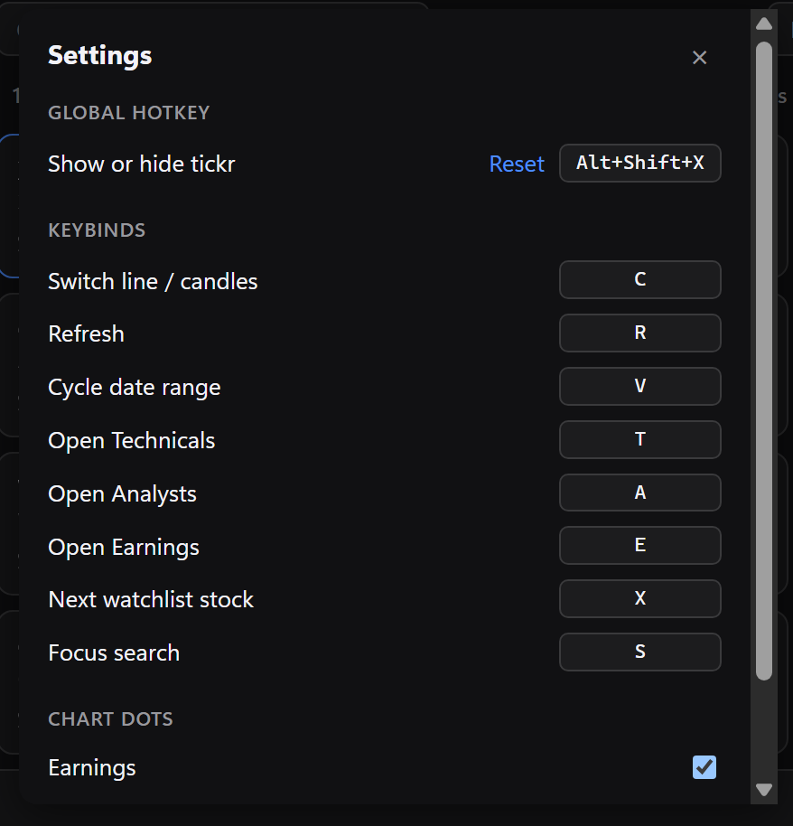

<p align="center"></p>

<p align="center">
  <a href="https://github.com/joezhuo2/tickr/releases/latest"></a>
  <a href="https://github.com/joezhuo2/tickr/releases"></a>
  <a href="https://github.com/joezhuo2/tickr/actions/workflows/ci.yml"></a>
  
  <a href="https://v2.tauri.app"></a>
  <a href="https://svelte.dev"></a>
  <a href="LICENSE"></a>
</p>

<p align="center">
  <a href="#download">Download</a> •
  <a href="#features">Features</a> •
  <a href="#settings-and-keybinds">Keybinds</a> •
  <a href="#screenshots">Screenshots</a> •
  <a href="#data">Data</a> •
  <a href="#files">Files</a> •
  <a href="#development">Development</a> •
  <a href="#contributing">Contributing</a> •
  <a href="#license">License</a>
</p>

> A small stock watcher built with Tauri 2 and Svelte 5 for the Windows tray
> and the macOS menu bar. The tray icon shows the company's logo with an up/down
> badge. Hover over it for the current price, the day's change and the pre-market
> or after-hours move. On macOS the price and change also sit next to the icon. A
> global hotkey opens a window with a chart, the analyst consensus, earnings and
> recent news.

<p align="center"></p>

## Download

Get the latest installer from
[Releases](https://github.com/joezhuo2/tickr/releases/latest):

- **Windows:** `tickr_x.y.z_x64-setup.exe`. Installs per user, no admin
  prompt.
- **macOS:** `tickr_x.y.z_universal.dmg` (Apple silicon and Intel), macOS 10.15
  or later. Drag tickr into Applications.

### First launch

tickr is not code-signed yet, so both systems warn the first time you open
it. The builds come from the public
[release workflow](.github/workflows/release.yml), so you can check what went
into them.

- **Windows:** SmartScreen says "Windows protected your PC". Click
  **More info**, then **Run anyway**. You only see this once.
- **macOS 15 (Sequoia) or later:** open tickr and close the warning that it
  can't be verified. Go to **System Settings > Privacy & Security**, scroll
  down to the message about tickr and click **Open Anyway**, then confirm
  with your password.
- **macOS 14 or earlier:** right-click tickr in Applications, choose
  **Open**, then **Open** again.
- **macOS says tickr "is damaged and can't be opened":** the download was
  quarantined. Run this, then open it again:

  ```bash
  xattr -dr com.apple.quarantine /Applications/tickr.app
  ```

### Updates

From v0.5.1, tickr updates itself. It checks GitHub 30 seconds after launch
and every 12 hours. When a new version is out, the tray tooltip says so and
the update item in the tray menu reads **Install vX.Y.Z and restart**.
Nothing installs until you click it. tickr then downloads the update, checks
its signature against the key built into the app, installs it and restarts.
The first-launch warnings above don't come back after an update.

**Check for updates** checks right away. Turn off **Check for updates
automatically** to stop the background checks. Versions before v0.5.1 can't
update themselves: install v0.5.1 once from Releases.

## Features

### Tray and hotkey

- **Tray icon:** the company logo with an up/down badge. Hover for the
  quote, left-click to open the window. Right-click holds every on/off
  setting: show pre-market/after-hours, show change as % or $, always on top,
  unload window when minimized, start hidden, launch at login, check for
  updates automatically and, on macOS, show price in menu bar. If something
  needs attention (the hotkey is taken, or launch at login could not be
  changed), the tooltip ends with a ⚠ line.
- **Global hotkey** (default `Ctrl+Alt+K` on Windows, `⌘⇧K` on macOS): opens
  the window, or minimizes it if it's focused. On macOS, where tickr has no
  Dock icon, it hides the window instead (or unloads it, when unload is on).
  Change it in [Settings](#settings-and-keybinds). If another app owns the
  hotkey at startup, the window footer shows the error until you pick one
  that works.
- **Launch at login** is off until you turn it on. Once on, it survives
  upgrades: tickr re-registers itself if an installer removed the entry,
  unless you turned it off in Task Manager.
- **Unload when minimized** (on by default): minimizing destroys the web view,
  so the app drops to one process using about 7 MB. The hotkey reopens it
  already painted with the last chart and quote, then refreshes in the
  background. The window opens on a dark or light background to match the
  OS theme, so it never flashes white.

Windows may hide new tray icons in the overflow menu (^). Drag it onto the
taskbar to keep it visible.

### Chart

- **Symbol and range:** search to change the symbol, pick a range from 1D to
  Max and switch between line and candles. 1D, 5D and 1M charts reload about
  once a minute.
- **Tooltip:** hover the chart, or use ← and →, for time, open, high, low,
  close and volume.
- **Event dots** along the bottom of the chart; hover the candle for details:

  | Dot | Marks |
  | --- | --- |
  | Blue | Earnings report: quarter and EPS vs estimate (last four quarters) |
  | Orange | Analyst initiation, upgrade or downgrade: firm, ratings, new target |
  | Yellow | One of the 20 latest headlines |
  | Green | Ex-dividend date and amount (6M to Max) |
  | Purple | Stock split and ratio (6M to Max) |

  Dots stack when a candle has more than one. Earnings, news and rating dots
  can be turned off in Settings.
- **Exports:** hover the chart for two buttons at its top left. One copies
  the chart as a PNG image, the other its candles as CSV (time in UTC, open,
  high, low, close, volume). A button turns green once the copy lands.
- **Refresh:** the button in the bottom bar fetches the quote and reloads the
  chart right away.

### Views

Each tab or button below swaps the chart out; click it again, or a range, to
go back.

- **Technicals:** click **Analyze** to run RSI, moving averages, candlestick
  patterns and volatility/Fibonacci targets on the candles of the selected
  range, on your machine (same candles, same result). You get a score from
  −100 to +100 with a bias and confidence, upside and downside targets for the
  next 10 bars, an invalidation level and the signals behind the score.
  Checkboxes toggle the overlays: moving averages, Bollinger bands (20, 2),
  VWAP, Fibonacci levels, targets, pattern markers and an RSI pane. VWAP resets
  each day on 1D, 5D and 1M and is anchored to the first candle on longer
  ranges. Under 200 candles shows a "Limited data" warning. Not investment
  advice.
- **Analysts:** the rating (Strong buy to Sell), average 12-month target and
  its upside also sit under the price on the left. The tab adds the target
  range against the current price and the count of each rating. Cached for 12
  hours; ETFs, indices and crypto have no coverage.
- **Earnings:** the next report date (confirmed or estimated) with EPS and
  revenue estimates, and the last four quarters with estimate, actual and
  surprise % (green beat, red miss).
- **Stats:** key statistics in Valuation, Trading, Dividends & splits, Shares
  & short interest, Profitability and Financials. ETFs get a Fund section and
  crypto a Crypto section. Changes, growth and returns are green or red.
- **News:** the 20 latest headlines, newest first, with publisher, time and a
  Positive / Negative / Neutral pill. The sentiment is guessed on your machine
  from the headline's words, so take it as a hint. Click one to open it in
  your browser.
- **Market:** the S&P 500, Nasdaq, Dow, Russell 2000 and VIX; the 10-year
  yield, crude oil, gold, the dollar index and Bitcoin; the 11 S&P sector ETFs
  by day change; and the day's top 5 gainers and losers. Click a row to chart
  it.

### Watchlist

Click the star next to the ticker to add or remove it. The star in the bottom
bar shows starred stocks as cards, refreshed every minute: price and percent
move for the session now trading (pre-market or after-hours when there is
one), biggest gain first. Click a card to chart it.

**Groups** split the watchlist into tabs such as "Tech" or "Crypto"; **All**
always shows every starred stock. Click **+** and type a name to add a group.
In a group tab, **Edit** shows every starred stock: click cards to add or
remove them, rename the group, or **Delete** it. Unstarring a stock removes it
from every group.

### Settings and keybinds

The gear at the bottom left opens Settings: the global hotkey (click the field
and press a new combination; **Reset** restores the default), in-window
keybinds and the chart dot toggles. Esc or a click outside closes it.

Click a keybind and press a new key to rebind it (an action already on that
key takes the old one), or Backspace to unbind it. Keybinds are ignored while
typing in a text field.

| Key | Action |
| --- | --- |
| `C` | Switch line / candles |
| `R` | Refresh |
| `V` | Cycle date range |
| `T` | Open Technicals |
| `A` | Open Analysts |
| `E` | Open Earnings |
| `X` | Next watchlist stock |
| `S` | Focus search |
| `,` | Toggle Settings |
| `W` | Toggle Watchlist |

## Screenshots

| | |
| :---: | :---: |
| <br>**Technicals** | <br>**Market** |
| <br>**News** | <br>**Analysts** |
| <br>**Earnings** | <br>**Stats** |
| <br>**Settings** | <br>**Chart** |

## Data

Quotes, charts, news and fundamentals come from Yahoo Finance's public chart,
search and quoteSummary endpoints. They are not an official API and can change
or rate-limit without notice, and quotes may be delayed. Logos come from
[Elbstream](https://elbstream.com/logos)'s logo API (formerly Parqet); the
**Logos by Elbstream** link in the footer is the attribution its free tier
requires. Analysis and sentiment run on your machine. Not investment advice.

## Files

| What | Windows | macOS |
| --- | --- | --- |
| Settings | `%APPDATA%\tickr\settings.json` | `~/Library/Application Support/tickr/` |
| Logo cache | `%LOCALAPPDATA%\tickr\` | `~/Library/Caches/tickr/` |
| Logs | `%LOCALAPPDATA%\dev.tickr.desktop\logs\tickr.log` | `~/Library/Logs/dev.tickr.desktop/` |

Logs rotate at 1 MB and keep two old files. Attach `tickr.log` to bug reports.

Uninstalling on Windows removes the launch-at-login entry. Check "Delete the
application data" in the uninstaller to also remove settings, the logo cache,
logs and WebView data.

## Development

### Build

Requirements: Rust 1.85+, Node 20+, and the
[Tauri 2 prerequisites](https://tauri.app/start/prerequisites/).

```bash
npm install
npm run tauri dev          # dev build with hot reload
npx tauri build            # installer (NSIS on Windows, .app and .dmg on macOS)
```

`npx tauri build` also signs the updater bundles, which needs the private key
(see [Updater key](#updater-key)). Without it, skip the updater artifacts:

```bash
npx tauri build -c '{"bundle":{"createUpdaterArtifacts":false}}'
```

The Windows installer installs per user (no UAC prompt), in English. On
macOS, `src-tauri/Info.plist` sets `LSUIElement` so tickr never shows a Dock
icon; the minimum version is macOS 10.15.

### Releasing

Releases are built by GitHub Actions. Bump the version in `package.json`,
`src-tauri/Cargo.toml` and `src-tauri/tauri.conf.json`, add a `CHANGELOG.md`
entry, then push a tag:

```bash
git tag v0.8.3
git push origin v0.8.3
```

`.github/workflows/release.yml` builds the Windows NSIS installer and a
universal macOS `.app`/`.dmg` with `tauri-apps/tauri-action`, and attaches them
to a **draft** release for that tag, along with the signed updater bundles and
`latest.json`. Failed asset uploads are retried twice. A last job checks that
`latest.json` lists Windows and both macOS architectures; if it fails, re-run
the failed jobs from the Actions tab, which re-uploads into the same draft. Review the notes and publish the release from the
Releases page. Installed copies only see it once it is published and marked
latest (not a pre-release), because the updater reads
`releases/latest/download/latest.json`.

#### Updater key

Updates are signed with a minisign key pair, separate from code signing and
free. The public key is `plugins.updater.pubkey` in
`src-tauri/tauri.conf.json`. The private key stays off the repo, in
`~/.tauri/tickr.key`, and CI reads it from the `TAURI_SIGNING_PRIVATE_KEY`
repository secret. Set it to the file's contents, unchanged (one base64 line):

```bash
gh secret set TAURI_SIGNING_PRIVATE_KEY < ~/.tauri/tickr.key
```

The key has no password, so leave `TAURI_SIGNING_PRIVATE_KEY_PASSWORD` unset.
If the secret is missing or mangled, tauri fails at the end of the build with
"Missing comment in secret key"; the release workflow checks the secret first
and fails right away instead.

Back the key up somewhere safe. If it is lost, installed copies reject every
future update and users have to reinstall by hand. A local `npx tauri build`
needs the same two variables, or it fails at the updater signing step.

`.github/workflows/ci.yml` runs `npm run check`, `npm test`,
`cargo clippy -- -D warnings` and `cargo test` (Windows and macOS) on every
push to `main` and every pull request.

#### Code signing

Releases are not code-signed yet (see [First launch](#first-launch)). macOS
builds are ad-hoc signed (`bundle.macOS.signingIdentity: "-"`), so Gatekeeper
reports an unidentified developer rather than a damaged app. Signing needs
certificates, so it is set up through environment variables at build time
rather than in the repo.

**macOS** needs a Developer ID Application certificate in the keychain and an
Apple ID app-specific password (or an App Store Connect API key) for
notarization. Remove `"signingIdentity": "-"` from `tauri.conf.json` first;
`tauri build` signs, notarizes and staples when these are set:

```bash
export APPLE_SIGNING_IDENTITY="Developer ID Application: Your Name (TEAMID)"
export APPLE_ID="you@example.com"
export APPLE_PASSWORD="app-specific-password"
export APPLE_TEAM_ID="TEAMID"
npx tauri build --target universal-apple-darwin
```

**Windows** can use an Authenticode certificate (set
`bundle.windows.certificateThumbprint`, `digestAlgorithm: "sha256"` and a
`timestampUrl` in `tauri.conf.json`) or Azure Trusted Signing (set
`bundle.windows.signCommand` to a `trusted-signing-cli` call). See
[Windows code signing](https://v2.tauri.app/distribute/sign/windows/) and
[macOS code signing](https://v2.tauri.app/distribute/sign/macos/). In CI, add
the Apple values as repository secrets (plus `APPLE_CERTIFICATE`, the base64
`.p12`, and `APPLE_CERTIFICATE_PASSWORD`) and uncomment them in
`release.yml`.

`npm run icon` regenerates the app icons from `scripts/make-icon.mjs`.

### Tests

```bash
cd src-tauri && cargo test # technical analysis (indicators, patterns, Fibonacci, scoring), quote, analyst, earnings, rating change, stats, market and news parsing, headline sentiment, sessions, tray tooltip and title, icon compositing, settings, watchlist symbols and groups, update menu labels
cd src-tauri && cargo test -- --ignored live   # analyst and market fetches against Yahoo (network)
npm test                   # formatters, watchlist sort, hotkey recording and display, keybinds
npm run check              # svelte-check
```

### Layout

```
src-tauri/src/
  quote.rs      Yahoo chart/search: fetch, parse, market session, extended-hours price
  analysis/     local technical analysis: indicators (RSI, SMA/EMA, ATR, σ), patterns, Fibonacci swing, score and targets
  analyst.rs    Yahoo quoteSummary: cookie/crumb session, consensus and price targets, 12 h cache
  earnings.rs   Yahoo quoteSummary: past EPS reports and next report date
  grades.rs     Yahoo quoteSummary: analyst upgrades, downgrades and initiations
  stats.rs      Yahoo quoteSummary: key statistics in labeled sections
  market.rs     Yahoo batch quotes and screeners: indices, macro, sectors, top movers
  news.rs       Yahoo search news: 20 latest headlines, newest first, web links only
  sentiment.rs  headline tone (positive, negative, neutral) from a financial keyword list
  poller.rs     background refresh: 15 s during market hours, 60 s pre/post, 15 min when closed
  tray.rs       tooltip text, macOS menu bar title, and the right-click menu
  trayicon.rs   icon (32 px, 36 px on macOS): logo in a rounded square plus a direction badge
  logo.rs       Elbstream logo fetch with a disk cache
  window.rs     create, OS theme background, reveal after first paint, unload on minimize, geometry
  hotkey.rs     global shortcut register/swap with rollback
  commands.rs   window commands and the injected first-frame payload
  settings.rs   JSON settings in the OS config dir
  autostart.rs  launch at login: restores the Run entry after upgrades
  updater.rs    background update checks, tray menu state, install and restart
src-tauri/windows/hooks.nsh   NSIS uninstall hook: autostart entry and app data
.github/workflows/  ci.yml (checks on push/PR), release.yml (installers, updater bundles and latest.json on tag push)
ui/src/         App, Left (ticker and details), Chart (canvas, analysis overlays), Technicals, Analysts, Earnings, Stats, Market, News, Watchlist, Search, Settings, Footer
```

### Memory (Windows 11, release build)

| State | Processes | Private |
| --- | --- | --- |
| Window open | 7 | 132 MB |
| Window unloaded (tray only) | 1 | 7 MB |

## Contributing

See [CONTRIBUTING.md](CONTRIBUTING.md). Bug reports should include
`tickr.log`, your OS and the tickr version.

## License

MIT. Company logos are provided by [Elbstream](https://elbstream.com/logos).
